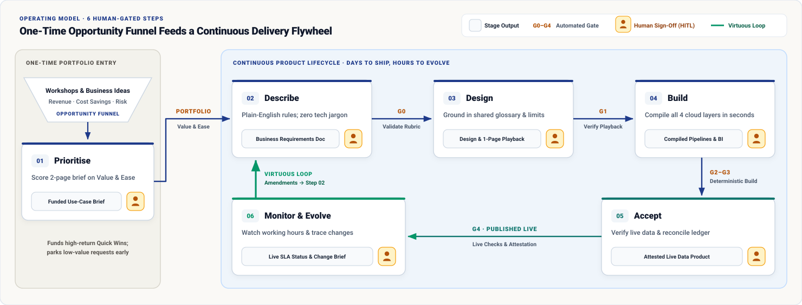
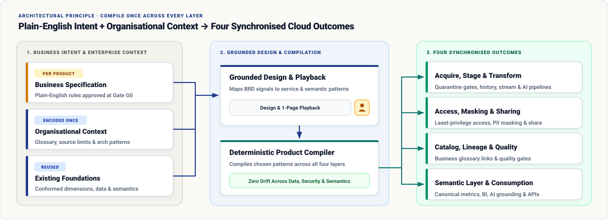

# Data Product Framework: Live Demonstration Walkthrough

Customer Context: Foodstuffs  
Platform: Google Cloud (BigQuery, Knowledge Catalog, Looker, and Gemini Platform)  
Worked Product: sales_performance (UC-SALES-001 and BRD-SALES-002)  

---

## Executive Summary

The Data Product Framework turns plain-English business intent into governed, tested data products on Google Cloud. Instead of letting requirements drift across separate wiki pages, SQL scripts, security tickets, and dashboard builds, every product travels through six human-gated stages where machine gates verify completeness and generate every synchronized cloud layer from a single source.

You can drive this entire demonstration in two ways depending on your audience. In an executive or product-owner session, you can drive every step conversationally from the Agent Harness by asking the agent to review forms, interview stakeholders, run zero-context Goldfish critiques, and explain trade-offs. In an engineering or architecture session, you can run the exact same gates deterministically from the terminal in under five minutes offline, or against a live PostgreSQL simulator streaming into BigQuery and Looker.

Roughly eighty percent of the lifecycle runs automatically through deterministic validation, multi-plane compilation, and scheduled checks. The remaining twenty percent is reserved strictly for four high-value human decisions: funding the right use case, approving plain-English business rules, reviewing golden pull-request diffs, and attesting domain figures before publication.

---

## Choosing Your Demonstration Track

Before starting, pick the pace and interface that best fit the room. Both tracks exercise the exact same worked example, sales_performance, and verify the exact same gates.

| Demonstration Mode | Duration | Cloud Setup Needed | Best Audience and Goal |
| :--- | :--- | :--- | :--- |
| Fast Offline Walkthrough (Harness or Terminal) | 10 to 12 minutes | None (runs locally from Git) | Executive sponsors, product owners, and architects reviewing governance, specs, Goldfish checks, and 4-plane compilation. |
| Full Live Sandbox Walkthrough (Terminal + Harness) | 25 to 30 minutes | BigQuery sandbox, Looker profile, and local PostgreSQL simulator | Data engineering and platform teams testing live quarantine gates, Type 2 history, Looker dashboards, and working-hours alerts. |

---

## Stage-by-Stage Demonstration Flow

### Stage 01: Prioritise

The journey begins before anyone writes a technical specification. A business sponsor fills in a short two-page Use-Case Definition form (use-case.pdf) for Sales Performance Insight (UC-SALES-001), linking the idea to SWOT priorities, operational weaknesses, and expected commercial outcomes.

What happens automatically:

1. The Use-Case Readiness Agent (assess-use-case) reads the submitted brief cold against the eleven-criterion rubric to check that every question is answered in plain business language with concrete evidence rather than vague aspirations.

2. Once ready, the scoring engine evaluates seven Business Value criteria and four Ease of Delivery criteria, including Data Readiness and Delivery Risk, scoring UC-SALES-001 at 3.05 for Value and 3.33 for Ease (107 out of 170 points) and placing it in the Quick Win quadrant on the Prioritisation Matrix (prioritisation.pdf).

When a human steps in:

The portfolio panel reviews the 2x2 Prioritisation Matrix, confirms that UC-SALES-001 is a high-readiness Quick Win while parking unready supplier-sharing ideas, and signs off funding to proceed to Stage 02.

Driving from the Agent Harness:

Ask the agent: Assess the filled use case in examples/sales_performance/define/use-case.yaml against the DPF rubric, explain its Value and Ease scores from portfolio.yaml, and tell me whether it is ready for panel sign-off.

Driving from the Terminal:

Open the filled PDF forms in examples/sales_performance/define (use-case.pdf, scorecard.pdf, and prioritisation.pdf) to show the 107 out of 170 Quick Win score, or rebuild them live from YAML using make templates.

---

### Stage 02: Describe (Gate G0)

With funding approved, the business owner captures what the product must deliver in the Business Requirements Document (brd.pdf and openspec/specs/products/sales/sales-performance/brd/spec.md). The form asks plain commercial questions such as what finest level of detail is needed ("an individual line on a customer order") and what happens when a customer changes segment ("past sales keep the segment that applied on the sale date").

What happens automatically:

1. Gate G0 validates that all rubric groups A through K are answered, every business metric and attribute exists in the shared glossary, and every requirement has a testable business scenario.

2. Gate G0 scans the entire BRD against the banned modelling vocabulary list, immediately failing if technical terms such as star schema, surrogate key, partition, SCD Type 2, or BigQuery appear in the business owner's document.

3. A zero-context Goldfish subagent (goldfish-verify at G0) reads the draft BRD with zero memory of the interview session to flag ambiguous measures or disguised architecture choices that slipped past the static word list.

When a human steps in:

The Sales Operations business owner reviews the jargon-free BRD, confirms the version history (including version 1.1.0 where 15-minute freshness was honestly relaxed to hourly after discovering the on-premises database blocked inbound cloud connections), and marks the BRD Approved.

Driving from the Agent Harness:

Ask the agent: Validate the sales_performance BRD at Gate G0, then run a zero-context Goldfish G0 check on the BRD to verify there are no vague measures or disguised technical choices.

Driving from the Terminal:

Run the BRD validator for sales_performance to show Gate G0 passing all thirteen requirements, fourteen acceptance scenarios, glossary bindings, and the zero-jargon check. To show a live failure, temporarily add the word partition to the BRD and watch Gate G0 block the build immediately.

---

### Stage 03: Design (Gate G1)

Now the architect or agent translates the approved business rules into a Technical Design Document (TDD), a product manifest (products/sales_performance/product.yaml), and a one-page plain-English playback sheet (semantics.md). Because the business asked for historical sales to keep the segment that applied on the sale date and reconcile with Finance and Merchandising, the design justifies Kimball Type 2 dimensions in silver with direct views in gold.

What happens automatically:

1. Gate G1 checks that every active requirement in the BRD resolves to a numbered design decision in the TDD, that departing from the default direct methodology is backed by an Architectural Decision Record, and that restricted customer contact fields carry policy tags and masking rules.

2. A fresh zero-context Goldfish subagent (goldfish-verify at G1) reads only product.yaml and the custom SQL files—never seeing the BRD or semantics.md—and reconstructs a blind business-language playback so any silent drift between what was coded and what was promised jumps out immediately.

3. Gate G1 computes a SHA-256 cryptographic digest of semantics.md and checks that it matches the signature stored in signoff.yaml; editing a single word of the product's business behaviour invalidates the signature automatically.

When a human steps in:

The business owner reads the single-page semantics.md playback—including the upfront Known Limitations section noting that segment history starts at go-live—and records their signature against the semantic digest.

Driving from the Agent Harness:

Ask the agent: Run a blind Goldfish G1 playback check on sales_performance using only product.yaml and its SQL files, compare it with semantics.md, and then verify Gate G1.

Driving from the Terminal:

Run the Gate G1 check on sales_performance to prove every requirement resolves and the SHA-256 semantic digest matches signoff.yaml.

---

### Stage 04: Build (Gates G2 and G3)

Once design meaning is locked, the framework acts as a deterministic multi-plane compiler. Rather than maintaining separate SQL repositories, Terraform security modules, Looker projects, and catalog scripts by hand, one manifest coordinates all four cloud planes simultaneously.

What happens automatically:

1. Gate G2 composes the pipeline stage by stage, selecting the right extraction, staging, modelling, and publishing skills and proving that every business scenario maps to an executable acceptance test.

2. Gate G3 compiles the manifest twice in memory to prove output is byte-for-byte deterministic, generating the Dataform or dbt project (complete with valid and rejects quarantine views and GEMINI.md agent guardrails), the Terraform module (datasets, IAM, policy tags, BigQuery sharing, and Knowledge Catalog quality scans), the LookML semantic model and Stephen Few dashboard, and the seven canonical Agentic Governance aspects.

3. Gate G3 diffs every generated file against the committed golden snapshot in tests/golden/sales_performance and runs a Goldfish G3 SQL critique to catch offline SQL traps before anything reaches pull-request review.

When a human steps in:

The data engineer inspects the clean golden diff in pull-request review to verify the exact SQL, Terraform, and LookML changes before merging and deploying.

Driving from the Agent Harness:

Ask the agent: Generate all cloud artefacts for sales_performance, run Gate G3 and the trace coverage matrix, and walk me through how requirement R-11 (quarantine bad order lines) and R-12 (mask customer contact details) compile across SQL, Terraform, LookML, and Knowledge Catalog.

Driving from the Terminal:

Run Gate G3 across all products, generate sales_performance into the generated folder, and print the end-to-end requirement traceability table from BRD requirement to decision, artefact, and test case.

---

### Stage 05: Accept (Gate G4)

Code compilation alone never publishes a data product. At Stage 05, the generated pipelines run against live or simulated source transactions, and Gate G4 demands passing runtime evidence bound to the exact SHA-256 build digest of the current manifest.

What happens automatically:

1. In a live sandbox demo, the PostgreSQL 16 simulator steps through five realistic retail events: order line amendments, customer re-segmentation from SMB to Enterprise, a late-arriving commit rescued by the 15-minute lookback window, an invalid order missing a customer ID (SO-1005) that triggers quarantine rule QR-1 and halts gold publication to protect executives from bad numbers, and finally the corrected order clearing quarantine.

2. Live Looker deployment validates the generated LookML views and Explores, deploys the Executive Sales Pulse dashboard, and executes every tile query against BigQuery.

3. The automated test runner executes all thirty-six live BigQuery SQL assertions and five static checks against build digest fd95e365e03e, passing 41 of 43 checks while deliberately holding Gate G4 red on the two human domain attestations (AT-5 and AT-8).

When a human steps in:

A Finance representative inspects net sales reconciliation and attests AT-5, and a Merchandising representative checks category alignment and attests AT-8. Only when both human attestations are recorded for the current build digest does Gate G4 turn green and allow publication to Knowledge Catalog.

Driving from the Agent Harness:

Ask the agent: Check Gate G4 for sales_performance, explain why it currently holds publication at 41 of 43 checks, and show the exact domain attestations required before registering the product in Knowledge Catalog.

Driving from the Terminal:

Run the Gate G4 check on sales_performance to demonstrate the intentional hold on AT-5 (Finance) and AT-8 (Merchandising), or run the five-step PostgreSQL simulator script to watch quarantine rule QR-1 block and then recover a live pipeline run.

---

### Stage 06: Monitor and Evolve (Day 2 Virtuous Loop)

After publication, the product monitors itself against business-aware service levels rather than noisy midnight cron alerts. Freshness for sales_performance is evaluated strictly during business working hours (Monday to Friday, 08:00 to 18:00), alongside daily order-line volume bounds and breaking schema-drift quarantines.

What happens automatically:

1. Scheduled monitoring evaluates live BigQuery freshness, volume, and Knowledge Catalog quality scan results against the product's observability policy, quietly skipping working-hours freshness checks on weekends or overnight so engineers never get paged for non-issues.

2. When a genuine breach occurs, the monitor command links the failure directly back to the affected BRD requirement and opens a pre-populated OpenSpec change proposal folder ready for triage.

When a human steps in:

The product steward reviews the generated OpenSpec change proposal. If fixing the issue only changes technical plumbing (such as upgrading from 15-minute watermark polling to continuous Datastream CDC once network routing opens), Gate G1 sees the semantic digest is unchanged and requires zero business re-approval; if business rules change, the amendment loops cleanly back to Stage 02.

Driving from the Agent Harness:

Ask the agent: Evaluate sales_performance monitoring against tests/evals/monitor-breach/run-evidence.json, explain which business requirement breached, and show how DPF opens a traced OpenSpec change proposal.

Driving from the Terminal:

Run the monitor command against the sample breach evidence file to display the business-calendar evaluation output and open a traced change folder.

---

## Quick-Reference Terminal and Harness Cheat Sheet

Use these concise sequences at the podium when driving the demonstration live.

### Track A: Five-Minute Offline Terminal Sequence (Zero Cloud Needed)

1. Activate the virtual environment in the data-product-framework directory and run dpf check --all --gate G3 to verify Gates G0 through G3 across both customer_orders and sales_performance.

2. Run dpf brd validate sales_performance to display the thirteen plain-English requirements, rubric completeness, and zero-jargon verification.

3. Run dpf generate sales_performance and dpf generate sales_performance --engine dbt to compile Dataform, dbt, Terraform, LookML, and Knowledge Catalog payloads in seconds.

4. Run dpf trace sales_performance --print to show every business requirement traced through design decisions, generated files, and acceptance tests.

5. Run dpf check sales_performance --gate G4 to demonstrate 41 passing sandbox checks and the hard safety hold awaiting Finance (AT-5) and Merchandising (AT-8) human attestations.

6. Run dpf monitor sales_performance --evidence tests/evals/monitor-breach/run-evidence.json and dpf eval to demonstrate Day-2 breach detection and all twenty-six framework behavioural evaluations passing.

### Track B: Live PostgreSQL Simulator to BigQuery and Looker Sequence

1. In examples/sales_performance/postgres-sim, run ./demo_ctl.sh start to launch the local PostgreSQL 16 OLTP simulator.

2. Run ./demo_ctl.sh step 1a --extract through step 2 --extract to stream order amendments and customer segment changes into raw BigQuery, then trigger Dataform full-refresh to populate Type 2 history in dim_customer.

3. Run ./demo_ctl.sh step 4 --extract to inject order SO-1005 with a missing customer ID and observe assert_stg_order_lines_no_rejects block gold publication while preserving the last good executive numbers.

4. Run ./demo_ctl.sh step 5 --extract to fix SO-1005 at the source, clear the quarantine ledger, and deploy the verified Looker dashboard via dpf looker deploy sales_performance --env test.

5. Record live evidence with dpf test run sales_performance --live --env test, capture human sign-offs with dpf test attest, and stop the simulator cleanly with ./demo_ctl.sh stop.

### Track C: Six Copy-Paste Prompts for the Agent Harness

1. Stage 01 Intake: Assess examples/sales_performance/define/use-case.yaml using assess-use-case and explain its Quick Win score in portfolio.yaml.

2. Stage 02 Describe: Run Gate G0 on sales_performance and execute a cold Goldfish G0 review on its BRD.

3. Stage 03 Design: Run a blind Goldfish G1 playback reconstruction from products/sales_performance/product.yaml and SQL alone, then verify Gate G1.

4. Stage 04 Build: Compile sales_performance across Dataform, Terraform, LookML, and Knowledge Catalog, run Gate G3, and trace requirement R-12 end to end.

5. Stage 05 Accept: Check Gate G4 for sales_performance and explain why publication is blocked until AT-5 and AT-8 are attested.

6. Stage 06 Monitor: Run dpf monitor on sales_performance using tests/evals/monitor-breach/run-evidence.json and explain the resulting OpenSpec change flow.

---

## Summary of Companion Demo Assets

1. Executive Consultancy Slide Deck: Live on the Presentation Server at /p/dpf-consultancy-overview (and locally at docs/presentation/dpf-consultancy-overview.html).

2. Interactive Functional Hierarchy Diagram (DPF-00): Live on the FHD Server at /fhd-server?cap=DPF (toggle to the Implementation lens to inspect CLI entrypoints).

3. Filled Define-Stage PDF Forms: Located in examples/sales_performance/define (use-case.pdf, scorecard.pdf, prioritisation.pdf, and brd.pdf).

4. Worked Specifications and Golden Outputs: Located in openspec/specs/products/sales/sales-performance, products/sales_performance, and tests/golden/sales_performance.
