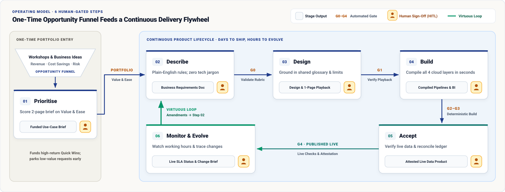
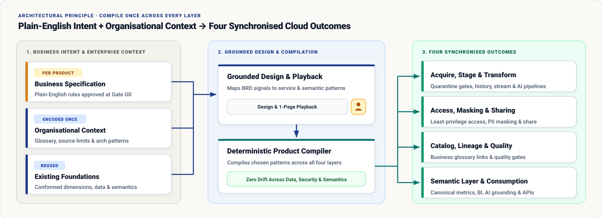

# Data Product Framework: End-to-End Demonstration Walkthrough

Showcase Domain: Enterprise Retail and Grocery Sales  
Platform: Google Cloud (BigQuery, Knowledge Catalog, Looker, and Gemini Platform)  
Worked Product: sales_performance (UC-SALES-001 and BRD-SALES-002)  

---

## Executive Summary

The Data Product Framework turns plain-English business intent into governed, tested data products on Google Cloud. Instead of letting requirements drift across separate wiki pages, SQL scripts, security tickets, and dashboard builds, every product travels through six human-gated stages where machine gates verify completeness and compile every synchronized cloud layer from a single specification.

You can run this walkthrough in two ways depending on your audience. In an executive or product-owner session, you can drive every stage conversationally from your coding agent (Gemini CLI, Antigravity, Claude Code, or Cursor) by asking the agent to onboard the workspace, assess use-case forms, run zero-context Goldfish critiques, and explain trade-offs. In an engineering or architecture session, you can run the exact same gates deterministically from the terminal in under five minutes offline, or end to end from a live PostgreSQL 16 transaction simulator through BigQuery into native Looker dashboards and an interactive Stephen Few semantic cockpit.

Roughly eighty percent of the lifecycle runs automatically through Layer-0 cloud bootstrap, deterministic contract checks, multi-plane compilation, and working-hours monitoring. The remaining twenty percent is reserved strictly for four high-value human decisions: funding the right use case, approving plain-English business rules, reviewing golden pull-request diffs, and attesting domain figures before publication.

---

## Choosing Your Demonstration Track

Pick the pace and setup depth that fit the room. Every track exercises the same worked product, sales_performance, with zero hard-coded project IDs, Looker URLs, or server endpoints in the repository.

| Demonstration Mode | Duration | Setup Required | Best Audience and Goal |
| :--- | :--- | :--- | :--- |
| Fast Offline Walkthrough (Agent or Terminal) | 10 to 12 minutes | Local Python virtual environment only (offline hydration) | Executive sponsors, product owners, and architects reviewing governance, specs, Goldfish verification, and four-plane compilation. |
| Full Live End-to-End Walkthrough (Source to Looker) | 25 to 30 minutes | Layer-0 GCP bootstrap, looker-cli OAuth login, and local PostgreSQL simulator | Data engineering and analytics teams testing live quarantine gates, Type 2 history, native Looker dashboards, and LookML semantic cockpits. |
| Clean Customer Template Onboarding | 5 minutes | GitHub Template clone plus bootstrap/onboarding-prompt.md | Platform leads seeing how a team strips worked examples and stands up a clean customer or domain repository on first run. |

---

## First-Time Workspace and Cloud Setup (Layer 0)

Before stepping into Stage 01, show how a new team or demo environment initializes the repository from the GitHub Template without manual console clicks or hard-coded URLs. Root agent files (GEMINI.md, CLAUDE.md, .cursorrules, and .clinerules) all symlink to AGENTS.md, which loads the canonical governance rules and thirteen agent skills automatically.

What happens automatically during setup:

1. Running bootstrap/onboarding-prompt.md in your coding agent asks five concise first-run questions: whether to keep the demo examples or strip them for a clean customer repo, the project name, the Google Cloud region and business calendar timezone, the deployment target (new GCP project, existing non-org-admin project, or offline-only), and an optional Presentation Server URL if you want to publish HTML decks and semantic cockpits centrally.

2. For cloud deployments, running bootstrap/deploy.sh (when creating a new GCP project) or bootstrap/deploy-existing-project.sh (when attaching to a pre-provisioned enterprise project) enables all required Google Cloud APIs, provisions Google-managed service agents, creates the dataform-runner and dpf-monitor service accounts via keyless impersonation, and creates the state bucket and initial Dataform repository. Passing --relax-domain-policy optionally relaxes domain-sharing constraints when testing external BigQuery sharing listings in a sandbox.

3. At the end of Layer-0 bootstrap (or immediately via bootstrap/hydrate_workspace.py --offline for offline demos), the hydration script writes your project ID, region, business timezone, service accounts, and Presentation Server URL into registry/agent-config.json and registry/platform-defaults.yaml, pre-populates examples/sales_performance/terraform/terraform.tfvars, and re-stamps worked-example golden snapshots.

4. For live semantic-layer visualization, Looker connection details stay strictly outside Git in ~/.config/looker-cli/config.yaml. You register your instance once with looker-cli profile add default --host your-instance.looker.app --port 443, sign in via browser PKCE OAuth with looker-cli session login --oauth, and grant the Looker Core service agent BigQuery Data Viewer, BigQuery Job User, and Service Usage Consumer roles on your target BigQuery project.

When a human steps in:

You answer the five onboarding prompts (or press Enter at the Presentation Server URL prompt if viewing HTML decks and cockpits locally from disk) and confirm the single Terraform apply prompt.

Driving from the Agent Harness:

Ask the agent: Execute bootstrap/onboarding-prompt.md with me to set up this workspace in demo mode.

Driving from the Terminal:

Create the Python virtual environment (.venv), install dpf in editable mode, and run either python3 bootstrap/hydrate_workspace.py --offline for a local-only demo or source bootstrap/deploy.sh --project-id my-dpf-demo --region us-central1 --timezone Australia/Perth --relax-domain-policy for a full cloud sandbox.

---

## Stage-by-Stage Demonstration Flow

### Stage 01: Prioritise

The product lifecycle begins before anyone writes a technical specification. A business sponsor fills in a short two-page Use-Case Definition form (use-case.pdf) for Sales Performance Insight (UC-SALES-001), linking the idea to SWOT priorities, operational weaknesses, and expected commercial outcomes.

What happens automatically:

1. The Use-Case Readiness Agent (assess-use-case) reviews the submitted brief cold against the eleven-criterion rubric to verify that every question is answered in plain business language with concrete evidence rather than vague aspirations.

2. Once ready, the scoring engine evaluates seven Business Value criteria and four Ease of Delivery criteria, including Data Readiness and Delivery Risk, scoring UC-SALES-001 at 3.05 for Value and 3.33 for Ease (107 out of 170 points) and placing it in the Quick Win quadrant on the Prioritisation Matrix (prioritisation.pdf).

When a human steps in:

The portfolio panel reviews the 2x2 Prioritisation Matrix, confirms that UC-SALES-001 is a high-readiness Quick Win while parking unready supplier-sharing ideas, and signs off funding to proceed to Stage 02.

Driving from the Agent Harness:

Ask the agent: Assess the filled use case in examples/sales_performance/define/use-case.yaml against the DPF rubric, explain its Value and Ease scores from portfolio.yaml, and tell me whether it is ready for panel sign-off.

Driving from the Terminal:

Open the filled PDF forms in examples/sales_performance/define (use-case.pdf, scorecard.pdf, and prioritisation.pdf) to show the 107 out of 170 Quick Win score, or rebuild them live from YAML using make templates.

---

### Stage 02: Describe (Gate G0)

With funding approved, the business owner captures what the product must deliver in the Business Requirements Document (brd.pdf and examples/sales_performance/specs/brd/spec.md). The form asks plain commercial questions such as what finest level of detail is needed ("an individual line on a customer order") and what happens when a customer changes segment ("past sales keep the segment that applied on the sale date").

What happens automatically:

1. Gate G0 validates that all rubric groups A through K are answered, every business metric and attribute exists in the shared glossary, and every requirement has a testable business scenario.

2. Gate G0 scans the entire BRD against the banned modelling vocabulary list, immediately failing if technical terms such as star schema, surrogate key, partition, SCD Type 2, or BigQuery appear in the business owner's document.

3. A zero-context Goldfish subagent (goldfish-verify at G0) reads the draft BRD with zero memory of the interview session to flag ambiguous measures or disguised architecture choices that slipped past the static word list.

When a human steps in:

The Sales Operations business owner reviews the jargon-free BRD, confirms the version history (including version 1.1.0 where 15-minute freshness was honestly relaxed to hourly after discovering the on-premises database blocked inbound cloud connections), and marks the BRD Approved.

Driving from the Agent Harness:

Ask the agent: Validate the sales_performance BRD at Gate G0, then run a zero-context Goldfish G0 check on the BRD to verify there are no vague measures or disguised technical choices.

Driving from the Terminal:

Run dpf brd validate sales_performance to show Gate G0 passing all thirteen requirements, fourteen acceptance scenarios, glossary bindings, and the zero-jargon check. To show a live failure, temporarily add the word partition to the BRD and watch Gate G0 block the build immediately.

---

### Stage 03: Design (Gate G1)

Now the architect or agent translates the approved business rules into a Technical Design Document (TDD), a product manifest (examples/sales_performance/product.yaml), and a one-page plain-English playback sheet (semantics.md). Because the business asked for historical sales to keep the segment that applied on the sale date and reconcile with Finance and Merchandising, the design justifies Kimball Type 2 dimensions in silver with direct views in gold.

What happens automatically:

1. Gate G1 checks that every active requirement in the BRD resolves to a numbered design decision in the TDD, that departing from the default direct methodology is backed by an Architectural Decision Record, and that restricted customer contact fields carry policy tags and masking rules.

2. A fresh zero-context Goldfish subagent (goldfish-verify at G1) reads only product.yaml, custom SQL files, and semantic-layer declarations—never seeing the BRD or semantics.md—and reconstructs a blind business-language playback so any silent drift between what was coded and what was promised surfaces immediately.

3. Gate G1 computes a SHA-256 cryptographic digest of semantics.md and checks that it matches the signature stored in signoff.yaml; editing a single word of the product's business behaviour invalidates the signature automatically.

When a human steps in:

The business owner reads the single-page semantics.md playback—including the upfront Known Limitations section noting that segment history starts at go-live—and records their signature against the semantic digest.

Driving from the Agent Harness:

Ask the agent: Run a blind Goldfish G1 playback check on sales_performance using only product.yaml and its SQL files, compare it with semantics.md, and then verify Gate G1.

Driving from the Terminal:

Run dpf check sales_performance --gate G1 to prove every requirement resolves and the SHA-256 semantic digest matches signoff.yaml.

---

### Stage 04: Build (Gates G2 and G3)

Once design meaning is locked, the framework acts as a deterministic multi-plane compiler. Rather than maintaining separate SQL repositories, Terraform security modules, Looker projects, and catalog scripts by hand, one manifest coordinates all four cloud planes simultaneously.

What happens automatically:

1. Gate G2 composes the pipeline stage by stage, selecting the right extraction, staging, modelling, semantic-layer, and publishing skills across thirteen stages and proving that every business scenario maps to an executable acceptance test.

2. Gate G3 compiles the manifest twice in memory to prove output is byte-for-byte deterministic, generating the Dataform or dbt project (complete with valid and rejects quarantine views and GEMINI.md agent guardrails), the Terraform module (datasets, IAM, policy tags, BigQuery sharing, and Knowledge Catalog quality scans), and the seven canonical Agentic Governance aspects.

3. Simultaneously, Gate G3 compiles the governed LookML semantic layer: symmetric-aggregate primary keys (_dpf_pk and Type 2 surrogate keys), timestamp validity windows on Type 2 dimensions, Gold summary measures, cancelled-order exclusions across net_sales, units_sold, and order_line_count, zero-byte BigQuery partition-metadata cache triggers, column-level dpf_pii_contact_access grants, and the Stephen Few Executive Sales Pulse dashboard.

4. Gate G3 diffs every generated file against the committed golden snapshot in tests/golden/sales_performance and runs a Goldfish G3 critique across SQL, Terraform, and LookML to catch offline dialect or fanout traps before pull-request review.

When a human steps in:

The data engineer inspects the clean golden diff in pull-request review to verify the exact SQL, Terraform, and LookML changes before merging and deploying.

Driving from the Agent Harness:

Ask the agent: Generate all cloud artefacts for sales_performance, run Gate G3 and the trace coverage matrix, and walk me through how requirement R-11 (quarantine bad order lines) and R-12 (mask customer contact details) compile across SQL, Terraform, LookML, and Knowledge Catalog.

Driving from the Terminal:

Run dpf check --all --gate G3, generate sales_performance for both Dataform and dbt, and print the end-to-end requirement traceability table from BRD requirement to decision, artefact, and test case.

---

### Stage 05: Accept and Visualise Over the Semantic Layer (Gate G4)

Code compilation alone never publishes a data product. At Stage 05, the generated pipelines run against live or simulated source transactions, both visualization experiences run strictly through the governed LookML semantic layer, and Gate G4 demands passing runtime evidence bound to the exact SHA-256 build digest of the current manifest.

What happens automatically:

1. In a live sandbox demo, the PostgreSQL 16 simulator (demo_ctl.sh) steps through five realistic retail events: order line amendments on SO-1001, customer C-001 re-segmentation from SMB to Enterprise and product P-200 recategorisation, a late-arriving commit rescued by the 15-minute lookback window, an invalid order missing a customer ID (SO-1005) that triggers quarantine rule QR-1 and halts gold publication to protect executives from bad numbers, and finally the corrected order clearing quarantine.

2. Running dpf looker deploy sales_performance --env test provisions the BigQuery connection and dpf_pii_contact_access user attributes automatically, pushes the generated LookML views and order_lines Explore, runs Looker's server-side validate_project compiler, imports the native Executive Sales Pulse dashboard, and executes all seven dashboard tile queries live against BigQuery.

3. Running dpf looker cockpit sales_performance --env test builds (or live-serves on a local port via --serve 8765) an alternative Stephen Few Perceptual Edge operational cockpit powered exclusively by looker-cli query runquery against sales_performance.order_lines with zero direct BigQuery SQL. It displays 2013 Bullet Graphs, ranked bars, two-point change slopes, Type 2 point-in-time attribution proof, and a cancelled-order semantic guardrail alongside an audit drawer showing the exact Looker-compiled SQL. Passing --publish uploads the cockpit to your configured Presentation Server (prompting for and saving the Presentation Server URL in registry/agent-config.json on first run if not yet set).

4. Running dpf test run sales_performance --live --env test executes the automated BigQuery SQL assertions and static checks against the current build digest, while Gate G4 deliberately holds publication red until the two human domain attestations (AT-5 and AT-8) are signed for that exact build digest.

When a human steps in:

A Finance representative inspects net sales reconciliation and attests AT-5, and a Merchandising representative checks category alignment and attests AT-8. Only when both human attestations match the current build digest does Gate G4 turn green and allow publication to Knowledge Catalog.

Driving from the Agent Harness:

Ask the agent: Deploy and verify the LookML semantic layer for sales_performance, build the Stephen Few semantic cockpit strictly over the order_lines Explore, and then check Gate G4 to show the human attestations required before Knowledge Catalog publication.

Driving from the Terminal:

Run the PostgreSQL simulator steps, execute dpf looker deploy and dpf looker cockpit, and run dpf check sales_performance --gate G4 to demonstrate the safety hold on AT-5 (Finance) and AT-8 (Merchandising).

---

### Stage 06: Monitor and Evolve (Day 2 Virtuous Loop)

After publication, the product monitors itself against business-aware service levels rather than noisy midnight cron alerts. Freshness for sales_performance is evaluated strictly during business working hours (Monday to Friday, 08:00 to 18:00 in the configured business timezone), alongside daily order-line volume bounds and breaking schema-drift quarantines.

What happens automatically:

1. Scheduled monitoring evaluates live BigQuery freshness, volume, and Knowledge Catalog quality scan results against the product's observability policy, quietly skipping working-hours freshness checks on weekends or overnight so engineers never get paged for non-issues.

2. When a genuine breach occurs, dpf monitor links the failure directly back to the affected BRD requirement and writes a pre-populated Markdown change brief under changes/ ready for triage.

When a human steps in:

The product steward reviews the generated change brief. If fixing the issue only changes technical plumbing (such as upgrading from 15-minute watermark polling to continuous Datastream CDC once network routing opens), Gate G1 sees the semantic digest is unchanged and requires zero business re-approval; if business rules change, the amendment loops cleanly back to Stage 02.

Driving from the Agent Harness:

Ask the agent: Evaluate sales_performance monitoring against tests/evals/monitor-breach/run-evidence.json, explain which business requirement breached, and show how DPF opens a traced change brief.

Driving from the Terminal:

Run dpf monitor sales_performance --evidence tests/evals/monitor-breach/run-evidence.json --open-change to display the business-calendar evaluation output and write a traced Markdown change brief under changes/.

---

## Quick-Reference Terminal and Harness Cheat Sheet

Use these concise sequences at the podium when setting up and driving the demonstration live.

### Track 0: First-Time Workspace, Cloud, and Looker Setup

1. Create the virtual environment and install DPF: python3 -m venv .venv and .venv/bin/pip install -e ".[dev]".

2. For offline demos without cloud provisioning, hydrate local defaults (and optionally record a Presentation Server URL): python3 bootstrap/hydrate_workspace.py --offline --region us-central1 --timezone Australia/Perth.

3. For a new cloud sandbox project, run Layer-0 bootstrap (prompts once on first run for an optional Presentation Server URL if --presentation-server-url is omitted): source bootstrap/deploy.sh --project-id my-dpf-demo --region us-central1 --timezone Australia/Perth --relax-domain-policy.

4. For an existing customer GCP project without Organization Admin rights, run: ./bootstrap/deploy-existing-project.sh --project-id my-existing-project --region australia-southeast1 --timezone Pacific/Auckland.

5. For live Looker steps, configure your local profile once (stored outside Git in ~/.config/looker-cli/config.yaml): looker-cli profile add default --host your-instance.looker.app --port 443, then looker-cli session login --oauth, and grant the Looker Core service agent BigQuery Data Viewer, BigQuery Job User, and Service Usage Consumer roles on your BigQuery project.

### Track A: Five-Minute Offline Terminal Sequence (Zero Cloud Needed)

1. Activate .venv in the data-product-framework directory and run dpf check --all --gate G3 to verify contracts, lint rules, and Gates G0 through G3 across both customer_orders and sales_performance.

2. Run dpf brd validate sales_performance to display the thirteen plain-English requirements, rubric completeness, and zero-jargon verification.

3. Run dpf generate sales_performance and dpf generate sales_performance --engine dbt to compile Dataform, dbt, Terraform, governed LookML, and Knowledge Catalog payloads deterministically.

4. Run dpf trace sales_performance --print to display every business requirement traced through design decisions, generated files, and acceptance tests.

5. Run dpf check sales_performance --gate G4 to demonstrate Gate G4 holding publication until current-digest SQL evidence and Finance (AT-5) and Merchandising (AT-8) attestations are present.

6. Run dpf monitor sales_performance --evidence tests/evals/monitor-breach/run-evidence.json and dpf eval to demonstrate Day-2 breach detection and all twenty-six framework behavioural evaluations passing.

### Track B: Live PostgreSQL Simulator to BigQuery, Looker, and Semantic Cockpit Sequence

1. Apply the product infrastructure in examples/sales_performance/terraform (terraform init and terraform apply using the terraform.tfvars file pre-populated by Layer-0 bootstrap), then start the local PostgreSQL 16 simulator in examples/sales_performance/postgres-sim with ./demo_ctl.sh start (supports Docker, GCE, or zero-Docker SQLite WAL).

2. Run DPF_GCP_PROJECT=your-gcp-project ./demo_ctl.sh step 1a --extract through step 3 --extract to stream order amendments, customer segment changes, and late-arriving commits into raw BigQuery, then trigger a Dataform full-refresh run to populate Type 2 history in dim_customer and dim_product.

3. Run DPF_GCP_PROJECT=your-gcp-project ./demo_ctl.sh step 4 --extract to inject invalid order SO-1005 (missing customer ID) and observe assert_stg_order_lines_no_rejects block gold publication while preserving the last good executive numbers.

4. Run DPF_GCP_PROJECT=your-gcp-project ./demo_ctl.sh step 5 --extract to fix SO-1005 at the source and clear the quarantine ledger, then rebuild gold tables cleanly.

5. Deploy and verify the native Looker project and dashboard with dpf looker deploy sales_performance --env test --project-id your-gcp-project, confirming all seven dashboard tile queries pass against BigQuery.

6. Build and live-serve the Stephen Few semantic cockpit purely over the LookML Explore with dpf looker cockpit sales_performance --env test --project-id your-gcp-project --serve 8765 (or add --publish to push to your Presentation Server, prompting for the URL on first run).

7. Record live G4 acceptance evidence with dpf test run sales_performance --live --env test, capture domain attestations with dpf test attest, check dpf monitor sales_performance, and stop the simulator cleanly with ./demo_ctl.sh stop.

### Track C: Seven Copy-Paste Prompts for the Agent Harness

1. Stage 00 Onboarding: Execute bootstrap/onboarding-prompt.md with me to configure this workspace, region, timezone, and optional Presentation Server URL.

2. Stage 01 Prioritise: Assess examples/sales_performance/define/use-case.yaml using assess-use-case and explain its Quick Win score in portfolio.yaml.

3. Stage 02 Describe: Run Gate G0 on sales_performance and execute a cold Goldfish G0 review on its BRD.

4. Stage 03 Design: Run a blind Goldfish G1 playback reconstruction from examples/sales_performance/product.yaml, SQL, and semantic-layer definitions alone, then verify Gate G1.

5. Stage 04 Build: Compile sales_performance across Dataform, Terraform, LookML, and Knowledge Catalog, run Gate G3 and a Goldfish G3 critique, and trace requirement R-12 end to end.

6. Stage 05 Accept and Visualise: Deploy sales_performance to Looker, build the Stephen Few operational cockpit strictly over the LookML semantic layer, and check Gate G4 to show what blocks publication until AT-5 and AT-8 are attested.

7. Stage 06 Monitor: Run dpf monitor on sales_performance using tests/evals/monitor-breach/run-evidence.json and explain the resulting change brief flow.

---

## Summary of Companion Demo Assets

1. Technical Whitepaper: Located offline at docs/presentation/dpf-whitepaper.html (or at {presentation_server_url}/p/dpf-whitepaper when a Presentation Server URL is configured on first run in registry/agent-config.json).

2. Executive Consultancy Slide Deck: Located offline at docs/presentation/dpf-consultancy-overview.html (or at {presentation_server_url}/p/dpf-consultancy-overview when configured).

3. Interactive Functional Hierarchy Diagram (DPF-00): Located offline at docs/fhd/dpf-data-product-framework-fhd.html (toggle to the Implementation lens to inspect repository entrypoints and CLI commands).

4. Governed LookML Semantic Cockpit: Generated on demand at generated/sales_performance/semantic_layer/sales_performance_semantic_cockpit.html via dpf looker cockpit sales_performance (live-refreshable via --serve or publishable via --publish).

5. Filled Define-Stage PDF Forms: Located in examples/sales_performance/define (use-case.pdf, scorecard.pdf, prioritisation.pdf, and brd.pdf).

6. Worked Specifications and Golden Outputs: Located in examples/sales_performance/specs, examples/sales_performance, and tests/golden/sales_performance.
