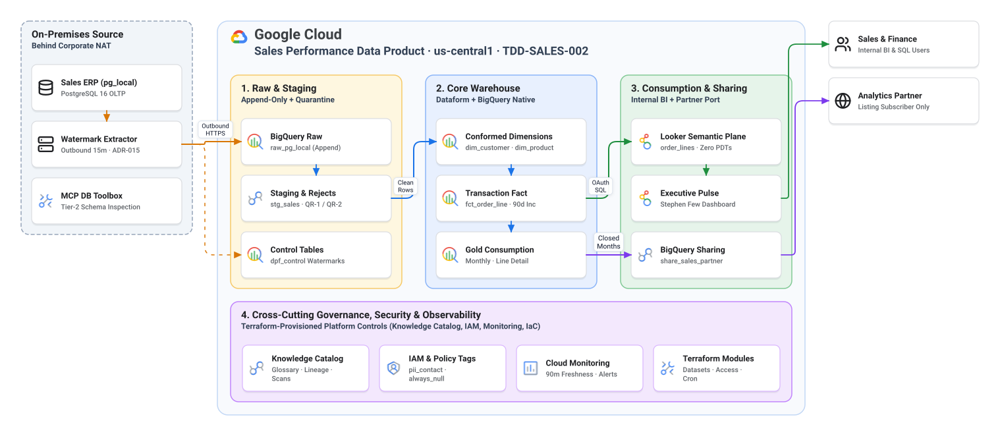
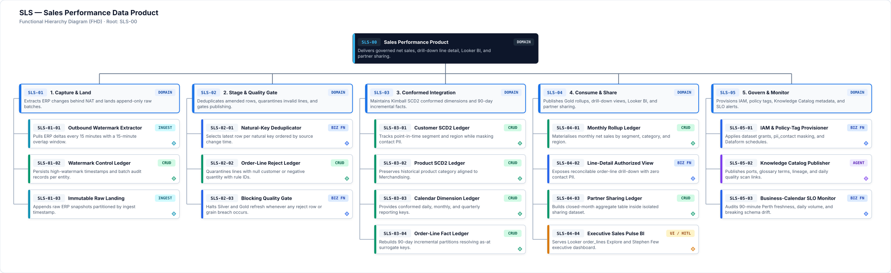
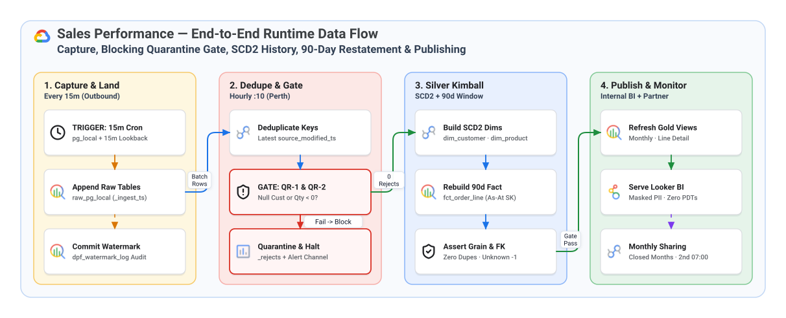
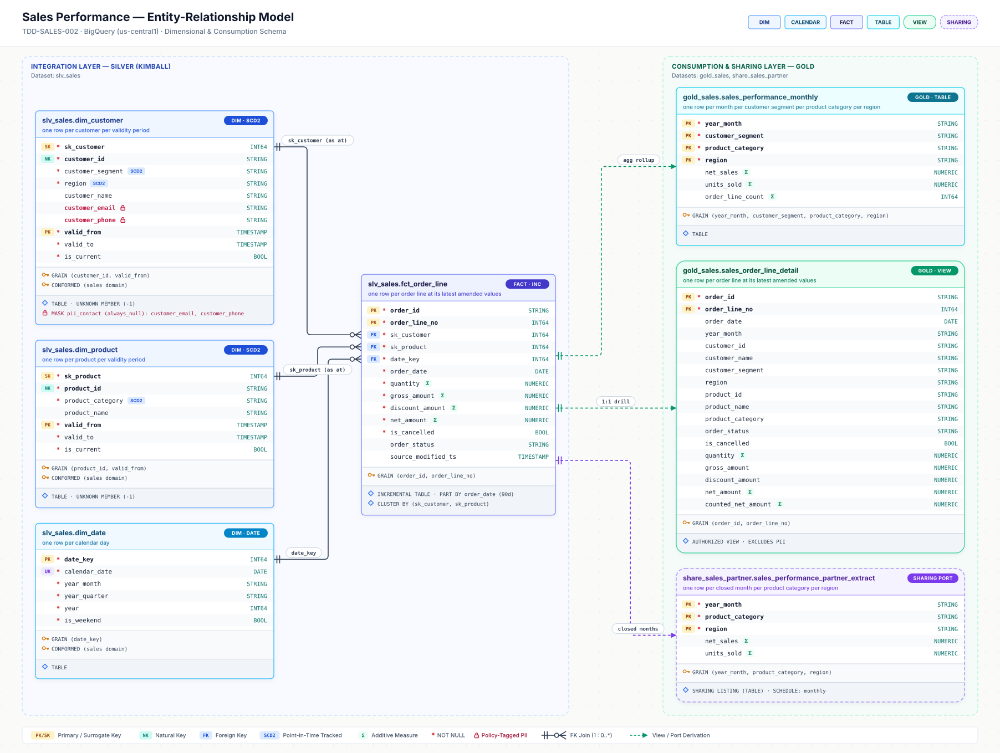
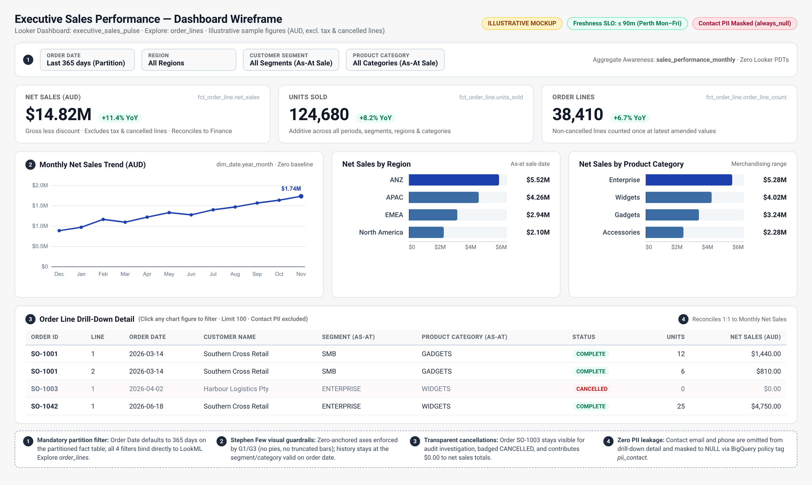

# Sales Performance — Technical Design Document

## Purpose

**TDD:** TDD-SALES-002 · **Satisfies:** BRD-SALES-002@1.2.0 · **Version:** 1.2.0 · **Owner:** Data Analytics

This Technical Design Document describes the architecture, modular breakdown, runtime data
flow, dimensional data model, executive BI experience, governance controls, and operational
model for the Sales Performance data product on Google Cloud. Sections 1 to 8 are written in
plain English for architecture reviewers, engineering leads, security and governance teams,
and business stakeholders. Machine-verifiable requirements, traceability matrices, and
physical implementation references live in Appendices A to D. The resolved machine-readable
manifest is `examples/sales_performance/product.yaml`.

| Field | Value |
|---|---|
| Document ID & Version | TDD-SALES-002 · v1.2.0 |
| Linked BRD & Use Case | BRD-SALES-002@1.2.0 · Use case UC-SALES-001 |
| Domain & Classification | Sales · INTERNAL-COMMERCIAL |
| Target Cloud Environment | Google Cloud · Project `data-product-framework` · Region `us-central1` (United States residency) |
| Accountable Business Owner | Sales Operations |
| Technical Owner / Data Steward | Data Analytics |
| Business Playback Sign-Off | `examples/sales_performance/specs/tdd/semantics.md` (`signoff.yaml`) |

---

## 1. Executive Design Summary

### Business Objective and Scope

Sales leadership, Sales Operations, Finance, and Merchandising need a single trusted view of
net sales growth across customer segments, product categories, and regions. The product
directly answers three business questions defined in BRD-SALES-002:

- **BQ-1 (Segment growth):** Which customer segments drove net sales growth this period,
  supporting quarterly segment investment allocation?

- **BQ-2 (Product and territory trends):** Which products and regions are growing or declining,
  supporting range and territory planning?

- **BQ-3 (Variance investigation and reconciliation):** What individual order lines make up a
  given period's net sales figure, supporting month-end reconciliation with Finance?

**In scope:** Hourly order-line ingestion during Perth working hours, point-in-time historical
tracking for segment, region, and product category, reconcilable monthly and order-line
outputs in BigQuery, a governed Looker Explore and executive dashboard, column-level masking
for customer contact details, and a monthly closed-period extract shared externally with the
analytics partner.

**Out of scope (Non-goals):** Forecasting and pipeline reporting; margin, cost, and
profitability analysis; and commission calculation.

### Key Architectural Decisions at a Glance

| Business Need | Plain-English Design Choice | Rationale | Reference |
|---|---|---|---|
| Shared Finance and Merchandising definitions plus point-in-time history | Kimball dimensional star schema in Silver (`slv_sales`), direct business views in Gold (`gold_sales`) | Plain views over current source data cannot preserve historical segment/category values or enforce cross-team conformed dimensions | D-1, D-2, D-4, D-5, D-6, ADR-SALES-002-01 |
| Hourly daytime freshness despite on-premises NAT boundary | Outbound 15-minute watermark extraction with 15-minute overlap lookback, paired with hourly Dataform builds | Live inspection showed the PostgreSQL source sits behind corporate NAT without logical replication; outbound HTTPS works today and upgrades cleanly to CDC later | D-10, ADR-SALES-002-02, ADR-015 |
| Unusable orders must never produce partial figures | Row-level quarantine (`stg_order_lines_rejects`) wired to a blocking publication gate | Any null customer or negative quantity halts Gold refresh and alerts the team so consumers keep seeing the last complete snapshot | D-12 |
| Mask customer contact details for general analysts | BigQuery policy tag (`pii_contact`, `always_null`) on `dim_customer`, plus omission from line-detail views | Analysts can identify customers and segments while email and phone remain hidden unless the reader holds fine-grained access | D-13 |
| External analytics partner needs monthly figures with zero internal access | Dedicated sharing dataset built monthly for closed months only, published via a BigQuery sharing listing | Partner receives subscriber-only listing access with zero customer-level columns and zero dataset or project roles | D-14 |
| Interactive executive BI without shadow SQL pipelines | Governed LookML Explore (`order_lines`) and Stephen Few dashboard (`executive_sales_pulse`) with zero Looker PDTs | Aggregate awareness accelerates monthly queries on governed BigQuery tables while keeping masking and metric logic single-sourced | D-19, ADR-018 |

---

## 2. Solution Architecture

### Plain-English Platform Walkthrough

- **On-Premises Source and Network Boundary:** The transactional Sales ERP (`pg_local`,
  PostgreSQL 16) sits inside the corporate network behind NAT with no inbound route from
  Google Cloud. A scheduled outbound extractor pulls incremental changes every 15 minutes over
  HTTPS into BigQuery, while live schema discovery during design uses the Tier-2 MCP database
  toolbox.

- **Raw and Staging Zone (`raw_pg_local`, `stg_sales`, `dpf_control`):** Landed batches are
  appended immutably with ingest timestamps and batch IDs alongside an atomic high-watermark
  control table. Hourly Dataform staging views deduplicate repeated or amended source rows and
  route invalid order lines into a dedicated reject ledger before any core table updates.

- **Core Warehouse Zone (`slv_sales`, `gold_sales`):** Dataform builds a Kimball star schema
  in BigQuery native storage — conformed Type 2 dimensions for customer and product, a
  conformed calendar table, and an incremental transaction fact table covering the 90-day
  correction window. Gold models provide fast monthly rollups and a reconcilable line-detail
  authorized view without duplicating modelling logic.

- **Consumption and External Sharing Zone:** Internal leaders and analysts query the governed
  Looker Explore (`order_lines`) and `Executive Sales Performance` dashboard (with zero Looker
  PDTs) or read Gold datasets directly. The external analytics partner consumes closed-month
  aggregates exclusively through an isolated BigQuery sharing listing (`share_sales_partner`).

- **Cross-Cutting Governance, Security, and Environment Promotion:** Terraform declaratively
  provisions datasets, least-privilege IAM, `pii_contact` policy tags, Dataform schedules, and
  Cloud Monitoring alerts across `test` (`dpf-sales-test`) and production
  (`data-product-framework`). Knowledge Catalog registers output ports, business glossary
  bindings, lineage edges, and daily quality scans.

---

## 3. Modular Functional Breakdown (FHD)

Interactive functional explorer: [Open Functional Hierarchy Explorer](assets/functional-hierarchy.html)

### Module Ownership Summary

The product is decomposed chronologically from left to right into five functional pillars and
seventeen atomic delivery units (`◇`). Every persistence module (`CRUD`) obeys single-writer
isolation (`1 atomic module : 1 primary write table`), giving clear blast-radius and IAM
boundaries across the delivery lifecycle.

| Pillar / Module UID | Capability / Module | Role | Primary Owned Table or Port | Plain-English Responsibility |
|---|---|---|---|---|
| **SLS-01** | 1. Capture & Land | Integration / Ledger | `raw_pg_local.*`, `dpf_watermark_log` | Extracts 15-minute ERP deltas behind NAT, lands append-only raw rows, and advances watermarks atomically |
| **SLS-02** | 2. Stage & Quality Gate | Business Fn / Ledger | `stg_order_lines_rejects` | Deduplicates amended keys, quarantines null-customer (`QR-1`) and negative-quantity (`QR-2`) rows, and blocks Gold refresh on any failure |
| **SLS-03** | 3. Conformed Integration | 4 Atomic CRUD Ledgers | `dim_customer`, `dim_product`, `dim_date`, `fct_order_line` | Maintains conformed SCD Type 2 history, unknown members (`-1`), and the 90-day incremental order-line fact |
| **SLS-04** | 4. Consume & Share | Ledgers / View / BI | `sales_performance_monthly`, `sales_order_line_detail`, `sales_performance_partner_extract`, Looker BI | Publishes monthly rollups, PII-free drill-down detail, Looker self-service BI, and the monthly external partner sharing listing |
| **SLS-05** | 5. Govern & Monitor | IaC / Agent / Monitor | Terraform IAM, Knowledge Catalog, Cloud Monitoring | Applies masking and schedules, publishes catalog metadata and lineage, and alerts on Perth business-hours freshness or volume breaches |

---

## 4. End-to-End Data Flow & Processing Lifecycle

### Capture and Refresh Cadence

Every 15 minutes, the outbound watermark extractor queries `pg_local` for records modified
since the previous committed watermark minus a 15-minute overlap lookback. That overlap
ensures transactions that started before the prior extract and committed moments later are
never missed. Raw rows append directly into `raw_pg_local`, and `dpf_watermark_log` advances
only once the batch completes cleanly.

Ten minutes past every hour (`Australia/Perth`), Dataform executes the staging, Silver, and
Gold pipeline. Staging views collapse lookback duplicates and source amendments down to one
row per natural key by taking the latest `source_modified_ts` (breaking ties by `_ingest_ts`).

### Quality Gate and Exception Handling

Before any Silver or Gold table refreshes, staging validates every order line against two
blocking rules: missing customer (`QR-1`) and negative quantity (`QR-2`). Because the legacy
ERP permits nullable customer IDs on draft order imports, order headers are left-joined so
malformed lines are never silently dropped.

If even one line fails validation, it is written to `stg_order_lines_rejects` stamped with its
rule ID, the blocking assertion fails the Dataform run, an alert fires to the sales data
channel, and all Gold tables remain frozen on the last complete trusted snapshot. Consumers
never see partial or half-updated numbers.

### History, Amendments, and Corrections

- **Point-in-time history (SCD Type 2):** Customer segment, customer region, and product
  category are tracked historically. For example, if *Southern Cross Retail* is in `SMB` on
  14 March 2026 and moves to `ENTERPRISE` on 1 June 2026, March net sales remain reported
  under `SMB` while June net sales report under `ENTERPRISE`. Customer name and contact
  details always display their current values.

- **Amendments and late-arriving members:** An order line amended multiple times counts once
  at its latest values. If a sale references a customer or product not yet landed in its
  dimension, the line resolves to the unknown member (`-1`) and raises a late-arrival warning
  rather than dropping revenue.

- **Cancellations and 90-day restatement window:** Cancelled lines stay visible in the fact
  and line-detail view marked `is_cancelled = TRUE`, while monthly rollups and Looker net
  sales exclude them automatically. Incremental runs rebuild only the trailing 90 days of
  `order_date` partitions, so corrections arriving within 90 days restate their period while
  changes older than 90 days leave published history untouched.

---

## 5. Data Model & Entity Relationships

Interactive schema explorer: [Open Interactive Entity-Relationship Explorer](assets/entity-model.html)

### Entity and Grain Summary

| Entity | Layer | Object Type | Plain-English Grain | History Behaviour | Primary Consumers |
|---|---|---|---|---|---|
| `slv_sales.dim_customer` | Silver | Conformed SCD2 Dimension (`table`) | One row per customer per validity window | Point-in-time (`customer_segment`, `region`); current (`name`, `email`, `phone`) | `fct_order_line`, Looker, Analysts (contact masked) |
| `slv_sales.dim_product` | Silver | Conformed SCD2 Dimension (`table`) | One row per product per validity window | Point-in-time (`product_category`); current (`product_name`) | `fct_order_line`, Looker, Merchandising |
| `slv_sales.dim_date` | Silver | Conformed Calendar (`table`) | One row per calendar day (2020–2030) | Static calendar | `fct_order_line`, Gold models, Looker |
| `slv_sales.fct_order_line` | Silver | Transaction Fact (`incremental_table`) | One row per order line at latest amended values | Joins dimensions as at `order_date`; 90-day restatement window | Gold marts, Looker Explore (`order_lines`) |
| `gold_sales.sales_performance_monthly` | Gold | Consumption Table (`table`) | One row per month, segment, category, and region | Point-in-time (via fact surrogate keys); excludes cancelled lines | Sales Leadership, Sales Ops, Finance, Looker aggregate awareness |
| `gold_sales.sales_order_line_detail` | Gold | Authorized View (`view`) | One row per order line at latest amended values | Point-in-time; retains cancelled lines (`counted_net_amount = 0`); zero PII | Sales Ops, Finance drill-down investigation |
| `share_sales_partner.sales_performance_partner_extract` | Gold (Share) | External Sharing Port (`table`) | One row per closed month, product category, and region | Point-in-time; closed months only; zero customer identifiers | External Analytics Partner (listing subscriber only) |

### Shared Definitions and Core Metrics

- **Conformed Dimensions:** `dim_customer`, `dim_product`, and `dim_date` are registered in
  the domain conformance registry as owned by `sales`. Finance reconciles period revenue using
  the same customer definition, and Merchandising aligns product categories to the shared
  range. Any other product declaring conflicting keys fails G1.

- **Core Business Calculations:** **Net Sales (AUD)** is `gross_amount - discount_amount`,
  excluding tax and cancelled order lines (`is_cancelled = FALSE`). **Units Sold** sums
  `quantity`, and **Order Lines** counts non-cancelled order lines. All four base fact
  measures (`quantity`, `gross_amount`, `discount_amount`, `net_amount`) are strictly
  additive, so totals sum cleanly across days, months, regions, segments, and categories
  without double counting.

---

## 6. Consumer Experience & Dashboard Mockups

### Output Ports and Access Summary

| Output Port | Type | Access Mechanism | Target Audience | Refresh Cadence |
|---|---|---|---|---|
| `executive_sales_pulse` | Looker Dashboard | `looker_folder_grant` | Sales Leadership, Sales Operations | Hourly (90-minute cache datagroup) |
| `sales_performance_explore` | Looker Explore (`order_lines`) | `looker_model_set` | Sales Leadership, Sales Operations, Finance | Live over Silver + Gold aggregate rollup |
| `sales_performance_monthly` | BigQuery Table | `dataset_grant` (`gold_sales`) | Sales Leadership, Sales Operations, Finance | Hourly (`:10` Perth) |
| `sales_order_line_detail` | BigQuery View | `authorized_view` | Sales Operations, Finance | Live view over Silver |
| `sales_performance_partner_extract` | BigQuery Sharing Listing | `sharing_listing` (`share_sales_partner`) | External Analytics Partner | Monthly (2nd at 07:00 Perth) |

Interactive HTML wireframe: [View Dashboard Wireframe HTML](assets/dashboard-mockup.html)

### Stakeholder User Journeys

- **Quarterly Segment and Territory Review (BQ-1 & BQ-2):** Sales leaders open *Executive
  Sales Performance*, filter by Order Date (defaulting to the last 365 days to prune
  partitions), Region, Customer Segment, or Product Category, and scan the three KPI tiles
  alongside the 12-month trend and zero-anchored ranked bar charts. Aggregate awareness routes
  high-level slices to `sales_performance_monthly` automatically with no Looker PDTs.

- **Variance Investigation and Finance Reconciliation (BQ-3):** When a regional total spikes,
  Sales Operations or Finance clicks through into the *Order Line Drill-Down Detail* table (or
  queries `sales_order_line_detail`). Cancelled lines such as `SO-1003` remain visible and
  clearly badged `CANCELLED` with `$0.00` counted net sales, while all non-cancelled lines sum
  exactly to the monthly headline figure. Customer contact email and phone never appear in the
  drill-down view.

---

## 7. Security, Privacy & Data Governance

- **Classification and Residency:** The product is classified `INTERNAL-COMMERCIAL` and
  deployed exclusively in `us-central1` to honour the BRD United States residency requirement.

- **Least-Privilege Access Control:** Internal consumer and analyst groups hold read-only
  `roles/bigquery.dataViewer` on `gold_sales` and `slv_sales`. Looker queries honour BigQuery
  policy tags via governed connections without creating scratch PDT datasets. The external
  analytics partner receives only subscriber access to the `sales_performance_monthly_extract`
  BigQuery sharing listing in its dedicated `share_sales_partner` dataset and holds zero
  project or dataset IAM roles.

- **Column-Level PII Protection:** `customer_email` and `customer_phone` on `dim_customer`
  carry policy tag `pii_contact` configured with `always_null` masking for both
  `analyst_group` and `consumer_group`. Only members of `contact_reader_group` read clear
  values. `sales_order_line_detail` and `sales_performance_partner_extract` omit contact
  columns entirely.

- **Catalog, Lineage, and Quality Assurance:** Output ports, column-level business glossary
  bindings, design-time lineage edges, and daily 06:30 data quality scans (`fct_order_line`,
  `sales_performance_monthly`) are registered in BigQuery Knowledge Catalog via the Tier-1
  Knowledge Catalog MCP server. Publication is blocked until `semantics.md` is signed and live
  G4 test evidence matches the build digest.

---

## 8. Operational Readiness, Feasibility & Risks

### Service Levels and Support

- **Freshness and Availability SLOs:** `sales_performance_monthly` must be no older than
  90 minutes between 08:00 and 18:00 `Australia/Perth` Monday to Friday (`OB-1`, probed every
  15 minutes). `sales_performance_partner_extract` must refresh within 32 days (`OB-2`, probed
  daily). Overall availability target is 99% over a rolling 28-day window.

- **Volume, Drift, and Incident Response:** Daily volume on `fct_order_line` is monitored
  against an expected baseline of 40,000 order lines per day with ±60% tolerance (`OB-3`).
  Additive source schema changes land and log automatically; breaking schema drift quarantines
  and alerts. All breaches notify `alert_channel`, follow
  `examples/sales_performance/RUNBOOK.md`, and can open a traced change brief via
  `dpf monitor sales_performance --open-change`.

### Source Feasibility and Agreed Trade-offs

Live inspection of `pg_local` via `mcp-toolbox-databases` confirmed clean natural keys and a
reliable `last_modified_ts` timestamp, but surfaced two source constraints that were raised to
Sales Operations rather than silently degraded:

1. **Hourly freshness instead of 15-minute CDC:** Corporate NAT blocks inbound connectivity
   from Google Cloud and logical replication (`wal_level = logical`) is disabled. The business
   accepted hourly daytime freshness (BRD 1.1.0), and switching to CDC later requires only
   swapping the capture skill without changing any Silver or Gold model.

2. **History starts at go-live:** The source ERP retains only each customer's current segment
   and region. Point-in-time tracking begins on the first production load and cannot be
   backfilled; earlier sales carry their go-live attributes, explicitly disclosed in
   `semantics.md`.

### Performance, Volume, and Cost Profile

With ~120 daily users and ~40,000 order lines per day (~14.6M rows/year), `fct_order_line` is
partitioned by `order_date` and clustered by `sk_customer, sk_product`, rebuilding only the
90-day correction window on each hourly run. Looker enforces a default 365-day partition
filter and routes summary queries to `sales_performance_monthly` via aggregate awareness,
keeping query latency low and BigQuery scan cost predictable.

### Key Risks, Assumptions, and Dependencies

| Risk / Assumption | Impact | Mitigation / Owner |
|---|---|---|
| On-premises outbound extractor host outage | Stale figures past 90-minute Perth SLO during business hours | `OB-1` alerts within 15 minutes; watermark log resumes cleanly with zero duplicates on recovery (Data Analytics) |
| Legacy ERP draft order imports with NULL `cust_id` | Could silently drop revenue or corrupt customer totals | Left-joined in staging, quarantined to `stg_order_lines_rejects` (`QR-1`), and blocks Gold refresh until resolved (Sales Ops / Data Analytics) |
| Late-arriving dimension rows before nightly sync | Fact lines could fail FK lookup or drop sales | Unknown member (`-1`) preserves revenue immediately and raises a late-arrival warning assertion (Data Analytics) |
| Historical segment/category values prior to go-live unavailable | Historical comparisons before go-live reflect go-live attributes | Documented explicitly in signed `semantics.md` Known limitations (Sales Operations) |

---

## Appendix A — Normative Technical Requirements

### Requirement: Kimball dimensional in silver
**Decision:** D-1 · **Satisfies:** R-4, R-5, R-6 · **Layer:** silver · **Methodology:** kimball · **ADR:** ADR-SALES-002-01

The silver layer SHALL use the `kimball` pack. This departs from the `direct` platform
default because the BRD asks for figures shared with two other teams (AG-1, AG-2) and for
attributes that keep the value that applied at the time (HB-1 to HB-3). See Appendix B.

#### Scenario: Recommendation matches the choice
- **WHEN** dpf evaluates the BRD signals for the silver layer
- **THEN** it SHALL recommend `kimball`
- **AND** the departure from the `direct` default SHALL be recorded in ADR-SALES-002-01

### Requirement: Direct business views in gold
**Decision:** D-2 · **Satisfies:** R-1, R-2, R-7 · **Layer:** gold · **Methodology:** direct

The gold layer SHALL use the `direct` pack. Modelling is done in silver; gold only names,
filters and aggregates for consumers, so no second methodology is warranted.

#### Scenario: Gold uses direct roles only
- **WHEN** gold models are composed
- **THEN** each SHALL use a role offered by the `direct` pack

### Requirement: Order line grain
**Decision:** D-3 · **Satisfies:** R-2, R-3 · **Model:** fct_order_line · **Grain:** order_id, order_line_no

`fct_order_line` SHALL hold one row per order line at its latest amended values. A uniqueness
check on the grain columns SHALL block publication when duplicates exist.

#### Scenario: Duplicate order line
- **GIVEN** two rows for the same order line
- **WHEN** the fact is built
- **THEN** the grain check SHALL fail and gold SHALL NOT be refreshed

### Requirement: Customer dimension keeps history
**Decision:** D-4 · **Satisfies:** R-4 · **Model:** dim_customer · **Grain:** customer_id, valid_from

`dim_customer` SHALL be a Type 2 dimension tracking customer segment and region, with validity
windows, a surrogate key and an unknown member. Name and contact details SHALL be current
values taken from the latest source row.

#### Scenario: Customer re-segmented
- **GIVEN** customer C-001 is SMB and becomes ENTERPRISE on 2026-06-01
- **WHEN** the dimension is built
- **THEN** it SHALL hold two versions whose validity windows do not overlap
- **AND** exactly one version SHALL be current

### Requirement: Product dimension keeps history
**Decision:** D-5 · **Satisfies:** R-6 · **Model:** dim_product · **Grain:** product_id, valid_from

`dim_product` SHALL be a Type 2 dimension tracking product category (HB-2), so category
trends stay comparable over time.

#### Scenario: Product recategorised
- **GIVEN** P-200 moves from GADGETS to WIDGETS on 2026-06-01
- **WHEN** the dimension and fact are built
- **THEN** March sales of P-200 SHALL resolve to GADGETS and June sales to WIDGETS

### Requirement: Conformance registered
**Decision:** D-6 · **Satisfies:** R-5, R-6

`dim_customer` and `dim_product` SHALL be registered as conformed dimensions owned by the
sales domain. A product declaring either at a different grain or key SHALL fail G1.

#### Scenario: Conflicting grain
- **GIVEN** another product declares `dim_customer` with a different natural key
- **WHEN** G1 runs for that product
- **THEN** it SHALL fail and name the owning domain

### Requirement: Transaction fact with additive measures
**Decision:** D-7 · **Satisfies:** R-1, R-7 · **Model:** fct_order_line

`fct_order_line` SHALL be a transaction fact whose measures (quantity, gross, discount and
net amount) are declared additive. Dimension keys SHALL be resolved as at the order date; a
missing member resolves to the unknown member and is reported, never dropped.

#### Scenario: Late-arriving customer
- **GIVEN** a line whose customer has not yet arrived in the dimension
- **WHEN** the fact is built
- **THEN** the line SHALL be kept with the unknown member
- **AND** a late-arrival warning SHALL be raised

### Requirement: Cancelled lines retained and excluded in gold
**Decision:** D-8 · **Satisfies:** R-8

Cancelled lines SHALL be kept in the fact with an `is_cancelled` flag and excluded from net
sales in the gold models, not by the consumer.

#### Scenario: Cancelled order
- **GIVEN** order SO-1003 is cancelled
- **WHEN** gold is built
- **THEN** SO-1003 SHALL appear in the line detail marked as cancelled
- **AND** April net sales SHALL exclude it

### Requirement: Partitioning and restatement window
**Decision:** D-9 · **Satisfies:** R-9 · **Model:** fct_order_line

`fct_order_line` SHALL be partitioned on order date and clustered on the customer and
product keys. Incremental builds SHALL rebuild only order dates inside the 90-day
correction window.

#### Scenario: Correction outside the window
- **GIVEN** a correction to a sale made 120 days ago
- **WHEN** the fact is rebuilt incrementally
- **THEN** that sale's partition SHALL NOT be rewritten

### Requirement: Outbound 15-minute watermark capture
**Decision:** D-10 · **Satisfies:** R-10 · **ADR:** ADR-SALES-002-02

Extraction from `pg_local` SHALL use outbound watermark capture on a 15-minute schedule (`*/15 * * * *`)
with a 15-minute lookback, because the PostgreSQL database sits behind corporate NAT with no inbound
route from Google Cloud (see Appendix D). Rows read twice SHALL be removed by staging deduplication.

#### Scenario: Late-committing transaction
- **GIVEN** a row committed with a change time just before the last watermark
- **WHEN** the next extract runs
- **THEN** the row SHALL be landed because it falls inside the lookback
- **AND** it SHALL be counted once after staging

### Requirement: Dataform on BigQuery native storage
**Decision:** D-11 · **Satisfies:** R-10, R-13

Engine `dataform` and storage `bigquery_native` SHALL be used for every layer, in project
`data-product-framework`, region `us-central1`. No reader outside the warehouse needs an
open table format; the partner is served by a sharing listing (D-14).

#### Scenario: Engine implements every role
- **WHEN** the pipeline is composed
- **THEN** the Dataform adapter SHALL implement every role the manifest uses

### Requirement: Unusable rows quarantined and publication blocked
**Decision:** D-12 · **Satisfies:** R-11

Order lines with no customer or a negative quantity SHALL be routed to a reject relation
with a reason. Any rejected row SHALL block the refresh of every gold model and raise an
alert. Gate behaviour is `block`.

#### Scenario: Line with no customer
- **GIVEN** a new order line with no customer
- **WHEN** the pipeline runs
- **THEN** the line SHALL appear in `stg_order_lines_rejects` with reason `QR-1`
- **AND** no gold model SHALL be refreshed
- **AND** the failed run SHALL raise an alert

### Requirement: Contact details masked for analysts
**Decision:** D-13 · **Satisfies:** R-12

Customer email and phone in `dim_customer` SHALL carry a policy tag whose masking rule
returns null to analysts, while a named contact group reads clear values. The line detail
view SHALL NOT expose contact columns.

#### Scenario: Analyst reads a customer
- **GIVEN** a member of the analyst group
- **WHEN** they select email and phone from `dim_customer`
- **THEN** both SHALL be null
- **AND** customer name and segment SHALL be visible

### Requirement: Partner extract via a sharing listing
**Decision:** D-14 · **Satisfies:** R-13 · **Model:** sales_performance_partner_extract · **Grain:** year_month, product_category, region

The partner extract SHALL hold closed months only, without customer detail, built monthly
into a dedicated sharing dataset and published as a sharing listing. The partner SHALL be
granted subscriber access to the listing and nothing else.

#### Scenario: Partner access is listing-only
- **WHEN** the extract is published
- **THEN** the partner principal SHALL hold only listing subscriber access
- **AND** it SHALL hold no dataset or project role

### Requirement: Monthly business view grain
**Decision:** D-15 · **Satisfies:** R-1, R-4, R-7 · **Model:** sales_performance_monthly · **Grain:** year_month, customer_segment, product_category, region

`sales_performance_monthly` SHALL hold one row per month, customer segment, product category
and region, using the segment, category and region that applied on the sale date.

#### Scenario: Monthly figures add up
- **WHEN** the monthly figures are summed across all rows
- **THEN** the total SHALL equal net sales from the non-cancelled lines of the fact

### Requirement: Line detail for drill-down
**Decision:** D-16 · **Satisfies:** R-2, R-8 · **Model:** sales_order_line_detail · **Grain:** order_id, order_line_no

`sales_order_line_detail` SHALL expose every order line, including cancelled ones, with the
segment, region and category that applied on the sale date, so any monthly figure can be
traced to its lines.

#### Scenario: Drill-down reconciles
- **WHEN** non-cancelled detail lines for one month, segment, category and region are summed
- **THEN** they SHALL equal that row of `sales_performance_monthly`

### Requirement: Staging deduplication
**Decision:** D-17 · **Satisfies:** R-3

Each staging model SHALL keep one row per natural key, choosing the latest source change
time and then the latest landing time, so amended and re-landed rows count once.

#### Scenario: Line landed three times
- **GIVEN** SO-1001 line 2 was landed three times with different values
- **WHEN** staging is built
- **THEN** one row SHALL remain, with quantity 6 and net amount 810.00

### Requirement: Service levels and monitoring
**Decision:** D-18 · **Satisfies:** R-10, R-11

Gold SHALL be no more than 90 minutes old between 08:00 and 18:00 Perth time on working
days, checked every 15 minutes. Daily volume, breaking schema drift, extract failures and
failed builds SHALL alert the sales data channel.

#### Scenario: Freshness breach
- **GIVEN** gold was last built two hours ago and it is 11:00 on a Tuesday
- **WHEN** the freshness check runs
- **THEN** an alert SHALL fire
- **AND** `dpf monitor` SHALL be able to open a change proposal for the breach

### Requirement: Governed Looker semantic explore and executive dashboard
**Decision:** D-19 · **Satisfies:** R-1, R-2, R-4, R-6, R-7, R-8, R-12 · **ADR:** ADR-018

The product SHALL publish an `order_lines` LookML explore over `fct_order_line` joined
`many_to_one` by surrogate key (`sk_customer`, `sk_product`, `date_key`), an aggregate table
for `sales_performance_monthly`, and an `executive_sales_pulse` dashboard using OAuth caller
pass-through so BigQuery policy-tag masking remains enforced.

#### Scenario: Interactive exploration and drill-down
- **WHEN** a sales manager slices net sales by region, segment or product category in Looker and drills into a figure
- **THEN** net sales SHALL exclude cancelled lines, join each sale to the segment and category valid on the sale date, and keep BigQuery column masking active for general analysts

---

## Appendix B — Traceability & Methodology Derivations

### Decision Coverage Matrix

| Design Area | Driven by (BRD Answer) | Platform Default | Decision(s) | Recorded in `product.yaml` |
|---|---|---|---|---|
| Methodology per layer | Agreement with Finance/Merchandising (AG-1, AG-2); history (HB-1..3) | `direct` | D-1, D-2 | `layers.silver.methodology`, `layers.gold.methodology` |
| Grain of each model | Level of detail (`order_id, order_line_no`) | — | D-3, D-4, D-5, D-14, D-15, D-16 | `grain_statement`, `grain_columns` |
| History semantics | History behaviour (HB-1, HB-2, HB-3) | `current_only` | D-4, D-5 | `history_semantics`, `attributes.scd_type`, `tracked` |
| Conformance & totals | Agreement with other teams; totalling | — | D-6, D-7 | `conformed_as`, `attributes.measures[].additivity` |
| Inclusions, exclusions & corrections | Exceptions (cancelled lines, 90-day restatement) | — | D-8, D-9 | `attributes.flags`, `restatement_window_days` |
| Capture & schedule | Timeliness (hourly daytime); source feasibility | per source registry | D-10, D-17 | `sources`, `orchestration.schedules`, `dedupe_order` |
| Engine & storage | External readers served via sharing listing | `dataform`, `bigquery_native` | D-11 | `layers.*.engine`, `layers.*.storage` |
| Quality & quarantine | Fitness (`stop and alert - do not publish`) | gate `block` | D-12 | `quality.gate_behaviour`, `quality.rules` |
| Protection & access | Protection (`customer contact details` restricted) | — | D-13 | `governance.access`, `governance.policy_tags` |
| Output ports & sharing | Required outputs (OUT-1..3); external partner | dataset grant | D-14, D-15, D-16, D-19 | `output_ports`, `semantic_layer` |
| Service levels & monitoring | Timeliness; fitness | — | D-18 | `observability` |

### Methodology Derivations

D-1 is driven by three BRD signals, not by preference:

| BRD Signal | Why `direct` Cannot Serve It |
|---|---|
| R-5 / AG-1: net sales must reconcile with Finance | Needs a shared definition of the entities both teams count |
| R-6 / AG-2: categories must match Merchandising's range | Needs a shared product definition owned by one domain |
| R-4, R-6 / HB-1 to HB-3: figures keep the value that applied at the time | Needs attribute state preserved over time, which a typed view over current-state source data cannot provide |

Had any of these been absent, `direct` would have been correct and cheaper.

---

## Appendix C — Physical Implementation Reference

Authoritative machine-readable specification: `examples/sales_performance/product.yaml`.

### Dataset and Storage Inventory

| Layer | Dataset Key | Physical Dataset | Models & Materialisation | Partition / Cluster / Notes |
|---|---|---|---|---|
| Raw | `raw` | `raw_pg_local` | `raw_orders`, `raw_order_lines`, `raw_customers`, `raw_products` (append-only native tables) | `DATE(_ingest_ts)` / `_source_pk_hash` |
| Staging | `staging` | `stg_sales` | `stg_customers`, `stg_products`, `stg_order_lines` (`view`), `*_history`, `*_rejects` | Dedupe by `source_modified_ts DESC, _ingest_ts DESC` |
| Silver | `silver` | `slv_sales` | `dim_customer`, `dim_product`, `dim_date` (`table`); `fct_order_line` (`incremental_table`) | `fct_order_line`: `PARTITION BY order_date` (90-day restatement), `CLUSTER BY sk_customer, sk_product` |
| Gold | `gold` | `gold_sales` | `sales_performance_monthly` (`table`), `sales_order_line_detail` (`authorized_view`) | `sales_order_line_detail` omits contact PII |
| Sharing | `share` | `share_sales_partner` | `sales_performance_partner_extract` (`table`, schedule `monthly`) | Dedicated dataset for BigQuery sharing listing `sales_performance_monthly_extract` |
| Control & Assertions | `control`, `assertions` | `dpf_control`, `dpf_assertions` | `dpf_watermark_log`, Dataform grain/SCD/reject assertions | Provisioned via Terraform `control.tf` and `datasets.tf` |

### Ingestion, Quarantine, Semantic Layer, and Infrastructure Summary

- **Extraction & Schedules:** Source `pg_local` (`postgres`), outbound watermark on `last_modified_ts`, 15-minute lookback, cron `*/15 * * * *`. Dataform workflows in `Australia/Perth`: `hourly` (`10 * * * *`) and `monthly` (`0 7 2 * *`).

- **Quarantine Rules (`gate_behaviour: block`):** `QR-1` (`stg_order_lines.customer_id` `not_null`, `severity: block`, `on_fail: quarantine`); `QR-2` (`stg_order_lines.quantity` `range min: 0`, `severity: block`, `on_fail: quarantine`).

- **Semantic Layer / LookML (`bigquery_sales`):** Explore `order_lines` over `fct_order_line` with `many_to_one` surrogate-key joins (`sk_customer`, `sk_product`, `date_key`), `always_filter_partition: true` (`365 days`), `datagroup_max_cache_age: "90 minutes"`, aggregate table `sales_performance_monthly`, zero Looker PDTs, and dashboard `executive_sales_pulse` (7 Stephen Few tiles).

- **Infrastructure & Governance:** Terraform module (`datasets.tf`, `access.tf`, `governance.tf`, `sharing.tf`, `orchestration.tf`, `monitoring.tf`, `quality.tf`, `control.tf`), policy tag `PT-1` (`pii_contact`, `always_null` on `dim_customer.{customer_email, customer_phone}`), Knowledge Catalog registration via `knowledge-catalog-mcp`, and `test` environment override targeting `dpf-sales-test`.

---

## Appendix D — ADRs & Source Feasibility Evidence

### Architecture Decision Records

- **ADR-SALES-002-01**: Kimball in silver, departing from the `direct` default (D-1).

- **ADR-SALES-002-02**: Watermark capture instead of CDC (D-10), reviewed when connectivity changes.

- **ADR-015** (platform): Outbound-only watermark extractor written as bespoke code (tool tier 5).

- **ADR-018** (platform): Governed LookML semantic explore and Stephen Few LookML dashboard with zero Looker PDTs (D-19).

### Live Source Inspection Evidence

Source inspected via `mcp-toolbox-databases` (tier 2), running locally against the PostgreSQL
JDBC URL.

| Check | Finding |
|---|---|
| `order_id, order_line_no` uniqueness | Confirmed unique |
| Change timestamp available | `last_modified_ts` (`TIMESTAMPTZ`) present, suitable for watermarking |
| Customer segment history at source | Not captured; the source holds current segment only |
| Continuous capture (CDC) feasible | No. The PostgreSQL database sits behind corporate NAT with no inbound route, and `wal_level = logical` and replication slots are not enabled |

Two consequences, both handled as business issues rather than quiet engineering compromises:

1. **Freshness.** The original 15-minute requirement could not be met. Raised to the
   business, who accepted hourly (BRD 1.1.0).

2. **Segment history.** The source does not retain it, so history begins at first load and
   cannot be backfilled. Sales before go-live carry the segment as at go-live. This is
   stated in `semantics.md`.

Both remain solvable later (CDC once connectivity exists) without redesigning the model.
